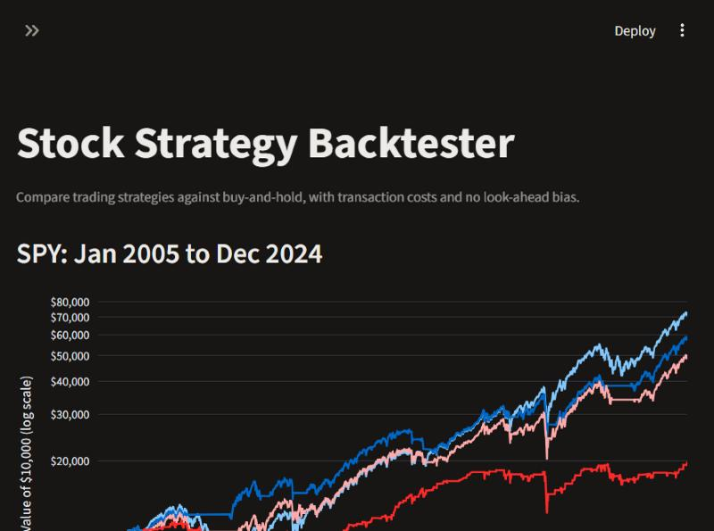

# Stock Strategy Backtester

Tests classic trading strategies against simply buying and holding, on real market data, with transaction costs and without look-ahead bias. Includes an interactive Streamlit app.



**Stack:** Python · pandas · NumPy · Streamlit · Plotly · yfinance · pytest

## Results: S&P 500 (SPY), 2005–2024

20 years, 5,033 trading days, 5 basis points (0.05%) charged on every trade.

| Strategy | CAGR | Volatility | Sharpe | Max Drawdown | Time Invested | Trades |
| --- | --- | --- | --- | --- | --- | --- |
| Buy & Hold | **10.3%** | 19.0% | 0.61 | -55.2% | 100% | 1 |
| SMA Crossover (50/200) | 9.1% | **13.3%** | **0.72** | **-33.7%** | 75% | 19 |
| Momentum (12-month, skip 1) | 8.3% | 14.5% | 0.62 | -33.7% | 78% | 91 |
| Mean Reversion (20-day z-score) | 3.5% | 14.5% | 0.31 | -40.2% | 26% | 293 |

On the Nasdaq-100 (QQQ) over the same period, buy-and-hold returned 14.6% a year (Sharpe 0.74, max drawdown -53.4%), and the SMA crossover returned 12.9% a year (Sharpe 0.82, max drawdown -28.6%).

**What this shows:**
- **Nothing beat buy-and-hold on raw return.** Over 20 years, sitting out of the market costs more than it saves.
- **Trend following was the better *risk-adjusted* bet.** The 50/200-day crossover gave up 1.2 points a year but cut the worst loss from -55% to -34% by stepping aside during 2008. Its Sharpe ratio was higher on both SPY and QQQ.
- **Short-term mean reversion failed on index ETFs.** Buying 20-day dips made money on 55% of invested days, but it was invested only 26% of the time and paid costs on 293 trades, so it fell far behind.

Reproduce it with `python -m backtester.report SPY 2005-01-01 2025-01-01`.

## How it works

```
backtester/
  strategies.py   Strategy base class + Buy & Hold, SMA Crossover, Momentum, Mean Reversion
  engine.py       turns target positions into a daily equity curve, with costs
  metrics.py      total return, CAGR, volatility, Sharpe, max drawdown, win rate, exposure
  data.py         adjusted prices from Yahoo Finance, cached to CSV
  report.py       compares all strategies and prints a table
app.py            Streamlit UI
tests/            14 pytest tests
```

Every strategy implements one method, `positions(prices)`, which returns a target position (1 = invested, 0 = cash) for each day. Adding a strategy means writing one small class.

### Avoiding the classic backtesting mistakes

| Pitfall | How this handles it |
| --- | --- |
| **Look-ahead bias** (trading on information you didn't have yet) | The engine shifts every position by one day: a signal from today's close earns tomorrow's return. A test feeds in a strategy that "knows" the future and checks that it can't profit. |
| **Ignoring costs** | Every change in position pays a configurable cost in basis points. A test confirms the exact charge in a flat market. |
| **Ignoring dividends** | Uses split- and dividend-adjusted prices, so buy-and-hold gets its full total return. |
| **Overfitting** | Default parameters are the textbook ones, not tuned to this data. The results above use them unchanged. |

### Known limits

- **Survivorship bias:** testing on today's popular ETFs ignores assets that disappeared.
- **Long/cash only:** no shorting, leverage, or position sizing.
- **Close-to-close fills:** real orders slip, especially in fast markets.
- Past performance doesn't predict future results. This is a learning project, not investment advice.

## Run it

```bash
python -m venv .venv
.venv/Scripts/activate        # macOS/Linux: source .venv/bin/activate
pip install -r requirements.txt pytest
streamlit run app.py          # interactive app at http://localhost:8501
python -m backtester.report QQQ 2010-01-01 2025-01-01
pytest
```
